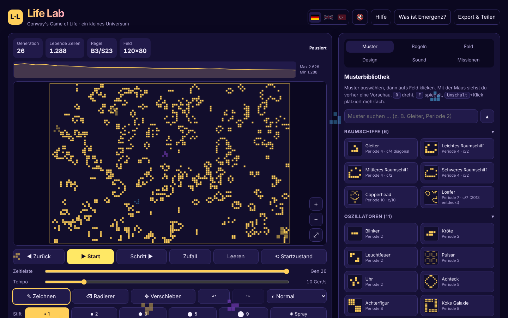
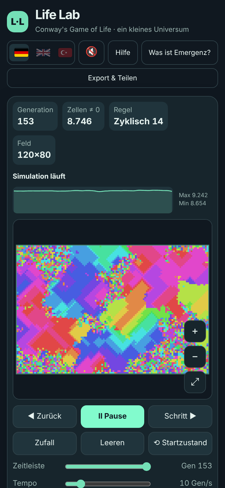

<div align="center">


# Life Lab

**Conways Game of Life zum Ausprobieren, Verstehen und Staunen**

Eine eigenständige Web-App: eine einzige HTML-Datei, keine Abhängigkeiten, läuft offline und lässt sich als App installieren.

🇩🇪 Deutsch · 🇬🇧 English · 🇹🇷 Türkçe

[**▶ Life Lab öffnen**](https://mrkero.github.io/Life-Lab/)

</div>

---

## Worum geht es?

Das **Game of Life** wurde 1970 vom Mathematiker John Horton Conway erfunden. Auf einem Gitter aus Zellen gelten nur vier Regeln:

| | Regel | Ergebnis |
|---|---|---|
| 1 | **Einsamkeit:** eine lebende Zelle mit weniger als 2 lebenden Nachbarn | stirbt |
| 2 | **Überleben:** eine lebende Zelle mit 2 oder 3 lebenden Nachbarn | lebt weiter |
| 3 | **Zu eng:** eine lebende Zelle mit mehr als 3 lebenden Nachbarn | stirbt |
| 4 | **Geburt:** eine tote Zelle mit genau 3 lebenden Nachbarn | wird lebendig |

Aus diesen einfachen, rein lokalen Regeln entstehen stabile Formen, pulsierende Oszillatoren, wandernde Raumschiffe und sogar „Kanonen“, die endlos Gleiter ausstoßen. Dieses Phänomen heißt **Emergenz**, und Life Lab soll es greifbar machen.

## Funktionen

### Simulation
- Zeichnen mit **6 Stiften** (1, 2, 3, 5, 9 Zellen und Sprühdose), Radierer und Verschieben
- **Zoom** per Mausrad, Pinch-Geste oder Buttons; Feldgröße bis 800 × 600, optional automatisch wachsend
- **Zeitleiste** zum Vor- und Zurückspulen durch die letzten 1000 Generationen
- Rückgängig / Wiederholen, Startzustand wiederherstellen, Tempo 1–60 Generationen pro Sekunde
- Ränder offen oder als **Torus** verbunden
- Ansichten: Normal, **Zellalter**, **Heatmap** und **Nachbarzahlen** (grün = wird geboren, rot = stirbt)
- Live-**Populationskurve**
- Automatische **Erkennung** von ausgestorbenen Feldern, Stillleben, Oszillatoren (mit Periode) und Raumschiffen (mit Geschwindigkeit)

### Musterbibliothek
- **36 geprüfte Muster** in fünf Gruppen: Raumschiffe, Oszillatoren, Stillleben, Kanonen & Wachstum, Methusalems
- Vorschau beim Platzieren, Drehen und Spiegeln, Suche und Gruppen zum Ein- und Ausklappen
- Import von **RLE** und Klartext (`.cells`), eigene Muster speichern

### Regeln & Automaten
- **10 bekannte Regeln** (HighLife, Seeds, Day & Night, Maze …) oder eine eigene B/S-Regel
- Weitere Automaten: **Brian's Brain**, **Wireworld** (Elektronen, Dioden, Taktgeber) und **zyklische Automaten**, deren Spiralwellen an die Belousov-Zhabotinsky-Reaktion erinnern
- Jeder Automat hat einen „Demo starten“-Button

### Lernen
- **Einführung** beim ersten Besuch: was das Game of Life ist, die vier Regeln und drei Startideen (jederzeit wieder über „Was ist das?“)
- **Erklär-Modus:** Zelle antippen und sehen, welche Nachbarn zählen, welche Regel greift und was in der nächsten Generation passiert, für alle vier Automaten
- Die Regeln als **illustrierte Karten** und in Worten
- **Emergenz-Fenster** mit 11 Beispielen aus der echten Welt: Vogelschwärme, Ameisenstraßen, Staus aus dem Nichts, Schneeflocken, Bénard-Zellen, BZ-Reaktion, Mizellen, Temperatur, Neuronen, Leben aus Atomen und ab wann Gold ein Metall ist
- **7 Missionen** mit automatischer Prüfung (z. B. „Baue ein Raumschiff“, „Methusalem“, „Totale Auslöschung“)

### Design & Sound
- **7 Themes**, eigene Farben und bis zu 5 gespeicherte Farbschemata
- **Sound** komplett live im Browser erzeugt: Effekte, Vertonung der Simulation (mehr Geburten = höhere Töne) und eigene Musik für besondere Modi
- Drei Sprachen: **Deutsch, Englisch, Türkisch**

### Export & Teilen
- Muster als **RLE-Text**, **Link**, **PNG** oder animiertes **GIF**

### Geheimnisse
In Life Lab sind **19 Easter Eggs** versteckt: zwei freischaltbare Designs, Zauberwörter, die alte Gamer und Hacker kennen, Rekorde und mehr. Welche du gefunden hast, siehst du unter *Credits & Geheimnisse*. Viel Spaß beim Suchen! 🥚

<table>
<tr>
<td width="62%"></td>
<td></td>
</tr>
<tr>
<td align="center"><sub>Ein freischaltbares Design</sub></td>
<td align="center"><sub>Am Handy: zyklischer Automat</sub></td>
</tr>
</table>

## Benutzen

**Direkt im Browser:** [Life Lab öffnen](https://mrkero.github.io/Life-Lab/)

**Als App installieren:**
- **Android (Chrome):** Seite öffnen → Menü ⋮ → *App installieren*
- **iPhone / iPad (Safari):** Seite öffnen → Teilen-Symbol → *Zum Home-Bildschirm*
- **Computer (Chrome / Edge):** Installieren-Symbol rechts in der Adressleiste

Danach startet Life Lab im Vollbild und funktioniert auch **offline**.

**Ohne Internet:** `index.html` herunterladen und per Doppelklick öffnen. Das funktioniert ebenfalls, nur das Installieren als App braucht die Online-Version.

## Tastenkürzel

| Taste | Aktion |
|---|---|
| `Leertaste` | Start / Pause |
| `→` / `N` · `←` / `B` | Eine Generation vor / zurück |
| `S` | Zurück zum Startzustand |
| `Z` / `C` | Zufall / Leeren |
| `Strg`+`Z` · `Strg`+`Y` | Rückgängig · Wiederholen |
| `D` `E` `V` `X` | Zeichnen · Radierer · Verschieben · Erklären |
| `[` `]` | Stift kleiner / größer |
| `R` / `F` / `Esc` | Muster drehen / spiegeln / abwählen |
| `+` `−` `0` | Zoom rein · raus · ganzes Feld |
| `G` · `M` | Raster an/aus · Ton an/aus |
| `?` | Hilfe |

## Technik

- Reines **HTML, CSS und JavaScript**, alles in einer Datei, ohne Frameworks und ohne externe Bibliotheken
- Darstellung mit **Canvas**; bei großen Feldern wird pixelweise gerendert
- Sound und Musik über die **Web Audio API**, ohne Audiodateien
- GIF-Export mit einem eigenen kleinen GIF-Encoder (LZW)
- **PWA:** `manifest.webmanifest` und Service Worker (`sw.js`) für Installation und Offline-Betrieb
- Einstellungen, Muster und Fortschritt werden lokal im Browser gespeichert (`localStorage`). Es werden **keine Daten gesendet**.

```
life-lab/
├── index.html            ← die komplette App
├── manifest.webmanifest  ← App-Name, Farben, Icons
├── sw.js                 ← Offline-Speicher
├── icons/                ← App-Symbole
└── screenshots/          ← Bilder für diese README
```

### Eine neue Version veröffentlichen
1. Neue `index.html` hochladen
2. In `sw.js` die Versionsnummer erhöhen (z. B. `life-lab-v3` → `life-lab-v4`), damit installierte Apps die neue Version laden

## Credits

- **Idee, Konzept & Tests:** Kerem
- Programmiert mit Unterstützung von **ChatGPT** (erste Version) und **Claude** (Überarbeitung & Erweiterungen)
- **Game of Life:** John Horton Conway (1937–2020), bekannt gemacht durch Martin Gardners Kolumne im *Scientific American* (1970)
- Viele Muster der Bibliothek wurden über Jahrzehnte von der weltweiten Life-Community entdeckt, dokumentiert im [LifeWiki](https://conwaylife.com/wiki/)

## Fehler oder Ideen?

Eröffne gern ein [Issue](../../issues). Kerem freut sich über jede Nachricht.

---

<details>
<summary><b>🇬🇧 English summary</b></summary>

**Life Lab** is a self-contained, offline-capable web app for exploring Conway's Game of Life: a single HTML file with no dependencies, installable as a PWA.

Features: drawing with several pen sizes, an explain mode that shows why a cell lives or dies, zoom, a timeline to rewind generations, automatic detection of still lifes, oscillators and spaceships, a library of 36 verified patterns, RLE import/export, 10 known rule sets plus Brian's Brain, Wireworld and cyclic automata, 7 missions, an illustrated explanation of emergence with real-world examples, live-generated sound and music, 7 themes, PNG/GIF export, 19 hidden Easter eggs, and a full English and Turkish translation (switch with the flags at the top).

Idea & concept: Kerem. Built with the help of ChatGPT and Claude.

</details>
